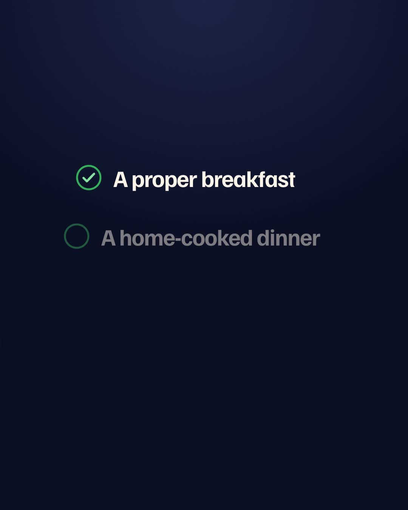

# Everyday Companion ("Alfred") — Swiggy Builders Club Demo

This repository hosts the official product walkthrough video and submission materials for **Alfred (Everyday Companion)** submitted to the **Swiggy Builders Club (Developer Track)**.

▶️ **[Click Here to Watch / Download the Full 96s HD Video (MP4)](https://github.com/ajai-lee/alfred-demo/releases/download/v1.0.0/alfred-promo-product-walkthrough-96s.mp4)**

---

## Quick Links
- **Direct Video Stream (MP4):** `https://github.com/ajai-lee/alfred-demo/releases/download/v1.0.0/alfred-promo-product-walkthrough-96s.mp4`
- **Release Page:** [v1.0.0 Release Tag](https://github.com/ajai-lee/alfred-demo/releases/tag/v1.0.0)
- **Official Product Landing Page:** [https://alfred.ratelolabs.com/](https://alfred.ratelolabs.com/)
- **Parent Entity:** Ratelo Technologies Private Limited (Ratelo Labs)

---

## Integrated Swiggy Services Highlighted in Demo
1. **Swiggy Food:** Morning breakfast routine with nutrition targets and calibrated budget selection.
2. **Swiggy Instamart:** Automated pantry and kitchen inventory check with weekly produce ordering via Buy Sheet.
3. **Swiggy Scenes:** Live events, shows, and standup comedy booking with companion coordination.
4. **Swiggy Dineout:** Weekend dining recommendations, instant table reservation, and bill discount integration.
